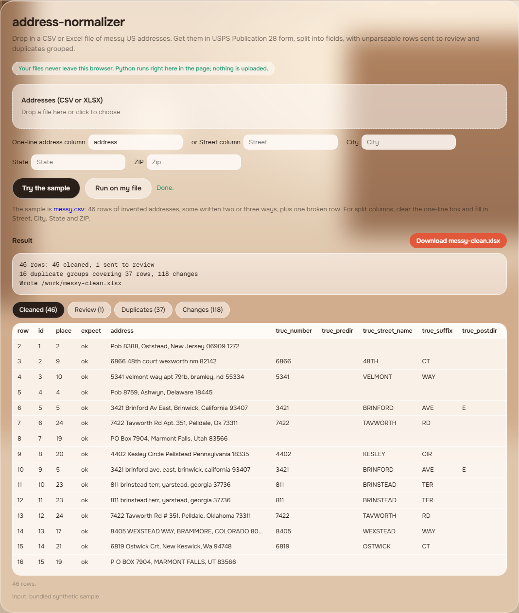
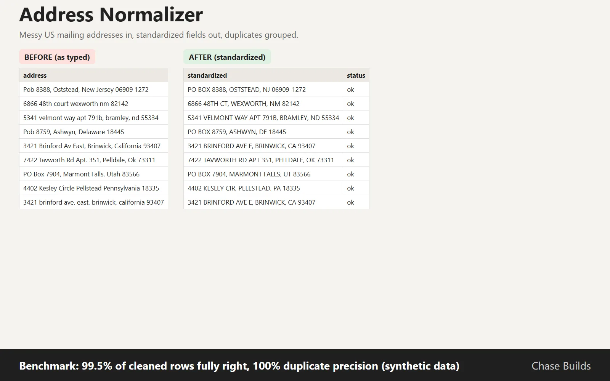

# address-normalizer

[](https://github.com/chasebuilds/address-normalizer/actions/workflows/ci.yml)  [](LICENSE)

**[Live demo: try it in your browser](https://chasebuilds.github.io/address-normalizer/)**. Drop in your own file or run the bundled sample with one click. The real package runs in the page with Pyodide, so files never leave your browser.

[](https://chasebuilds.github.io/address-normalizer/)

Cleans messy US mailing addresses in a CSV or Excel file. Each address is written the way USPS Publication 28 writes it (`Street` to `ST`, `Illinois` to `IL`, `Apartment` to `APT`, ZIP with its leading zero back), split into fields, and checked. Rows it cannot parse go to a review sheet with the reason. Rows that are the same address written differently are grouped. Everything runs offline: no geocoding, no API keys.

## Measured result

Messy copies of invented addresses with known answers were run through the tool and scored. The table below is written by the benchmark script from a real run, not typed by hand. Method, misses and limits: [BENCHMARK.md](BENCHMARK.md).

<!-- benchmark:start -->
| Measure | Result |
|---|---:|
| Rows (messy copies of 5,000 fake addresses, plus broken rows) | 8,632 |
| Cleaned rows with every field right | **99.5%** (8,294 of 8,332) |
| Parseable rows with every field right (review counts as wrong) | **98.7%** |
| Duplicate pairs found (recall) | **97.8%** (4,421 of 4,520) |
| Duplicate pairs that were right (precision) | **100.0%** (4,421 of 4,421) |
| All rows sent to review | 3.5% (300) |
| Parseable rows sent to review | 0.8% (68) |
| Broken rows sent to review | 100.0% (232 of 232) |
<!-- benchmark:end -->

The parseable rows sent to review have no commas and a city with a street-suffix word in it (`Lake Bramley`), so the street could end in two places. The tool flags those instead of guessing. Most wrong fields come from a spelled-out direction after the street (`Rd North`) in a row with no commas, which is read as part of the city. [LIMITATIONS.md](LIMITATIONS.md) covers both.



## Example

| Input | Output |
|---|---|
| `123 n Main street apt 4, Springfield, Illinois 62704` | `123 N MAIN ST APT 4, SPRINGFIELD, IL 62704` |
| `  456  Oak Park Ave #12 Brookvale ma 2134` | `456 OAK PARK AVE # 12, BROOKVALE, MA 02134` |
| `P.O. Box 77, Dunmore, NY 123456789` | `PO BOX 77, DUNMORE, NY 12345-6789` |
| `789 W Elm Rd SE Cedar Falls IA 50613` | `789 W ELM RD SE, CEDAR FALLS, IA 50613` |
| `12 Broadway New York NY 10001` | review: could not tell where the street ends and the city starts (add commas) |

## Quick start

Windows (on macOS or Linux use `.venv/bin/` in place of `.venv\Scripts\`):

```
python -m venv .venv
.venv\Scripts\python -m pip install -e .
.venv\Scripts\addrnorm clean samples\messy.csv --column address -o samples\messy-clean.xlsx
```

The sample is 46 generated rows (25 fake addresses, some written 2 or 3 ways, plus a broken row). The `true_*` columns hold the right answers. The command prints:

```
46 rows: 45 cleaned, 1 sent to review
16 duplicate groups covering 37 rows, 118 changes
Wrote samples\messy-clean.xlsx
```

Addresses split across columns:

```
addrnorm clean customers.xlsx --street Street --city City --state State --zip Zip -o clean.xlsx
```

| Option | Effect |
|---|---|
| `--column NAME` | column with the whole address on one line |
| `--street`, `--city`, `--state`, `--zip` | separate columns instead (`--street` is required, the others optional) |
| `--sheet NAME` | sheet to read from an Excel file (default: the first) |
| `-o FILE` | output workbook (default `addresses-clean.xlsx`) |

Exit codes: `0` done, `2` the file or a column could not be read.

## The output workbook

| Sheet | What it holds |
|---|---|
| Cleaned | every input row and column, then `standardized`, `status` (`ok` or `review`), the split fields (`number`, `predir`, `street_name`, `suffix`, `postdir`, `unit_type`, `unit_id`, `po_box`, `city`, `state`, `zip5`, `zip4`) and `duplicate_group` |
| Review | rows that could not be parsed, the reason, and the best partial guess |
| Duplicates | groups of rows that clean to the same address |
| Changes | one line per change: row, rule (`suffix`, `state`, `zip`, `unit`, `directional`, `po_box`, `case`, `spacing`, `punctuation`), before and after |

Row numbers match the spreadsheet row in the input file (the header is row 1).

## Rules

| Rule | Example |
|---|---|
| Street suffixes to Publication 28 abbreviations | `Avenue`, `Av`, `Ave.` to `AVE`; `Parkway`, `Pky` to `PKWY` |
| Directionals | `North` to `N`, `Southwest` to `SW`, before or after the street name |
| Unit designators | `Apartment` to `APT`, `Suite` to `STE`, `#12` to `# 12`, `Apt12` to `APT 12` |
| State names to codes | `west virginia` to `WV`, `District of Columbia` to `DC` |
| ZIP and ZIP+4 | `2134` to `02134`; `021340012`, `02134 0012`, `21340012` to `02134-0012` |
| PO boxes | `P.O. Box`, `Post Office Box`, `POB` to `PO BOX` |
| Casing, spaces, periods | upper case, single spaces, periods removed |
| Review | no ZIP, no state, no house number, ZIP first digit wrong for the state, text left over, street and city split ambiguous |

A word that could be a suffix or a direction but is the street name keeps its place: `10 North St` stays street `NORTH`, and `456 Park Ln` is street `PARK`, suffix `LN`.

As a library:

```python
from address_normalizer import parse

a = parse("123 n Main street apt 4, Springfield, Illinois 62704")
a.standardized   # '123 N MAIN ST APT 4, SPRINGFIELD, IL 62704'
a.street_name, a.suffix, a.unit_id, a.zip5   # ('MAIN', 'ST', '4', '62704')
a.issues         # [] when it parsed cleanly, else the reasons
```

## Limits

Short version: it fixes format, not facts. An address that does not exist comes out looking clean. Rows without commas are split by rules, and some go to review. Duplicates need an exact match after cleaning, with no fuzzy matching. Full list: [LIMITATIONS.md](LIMITATIONS.md).

## Development

```
.venv\Scripts\python -m pip install -e ".[dev]"
.venv\Scripts\python -m pytest --cov
.venv\Scripts\python -m ruff check .
.venv\Scripts\python -m mypy
.venv\Scripts\python -m benchmark.run_benchmark
```

The sample file was made with `python -m benchmark.generate --seed 7 --places 25 --out samples/messy.csv`.

## License

MIT. See [LICENSE](LICENSE).
